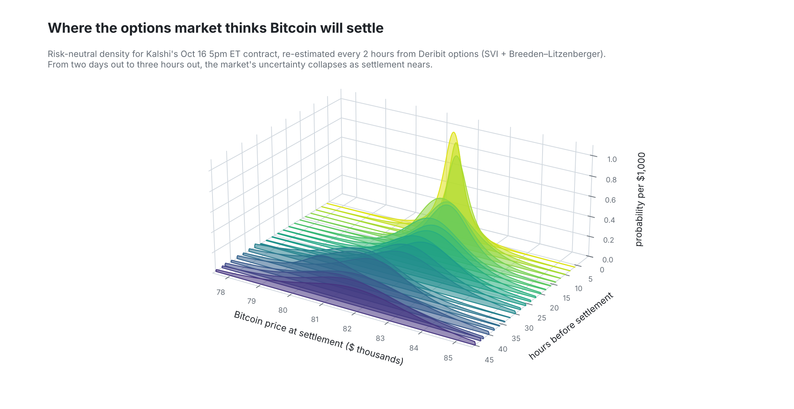
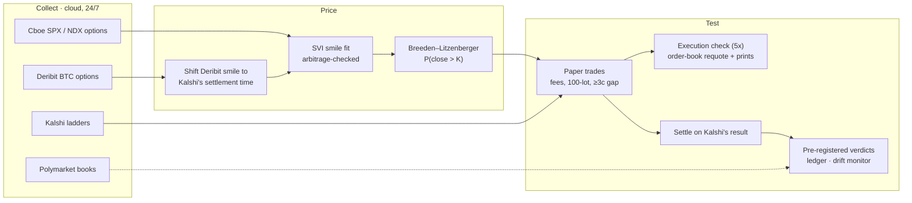
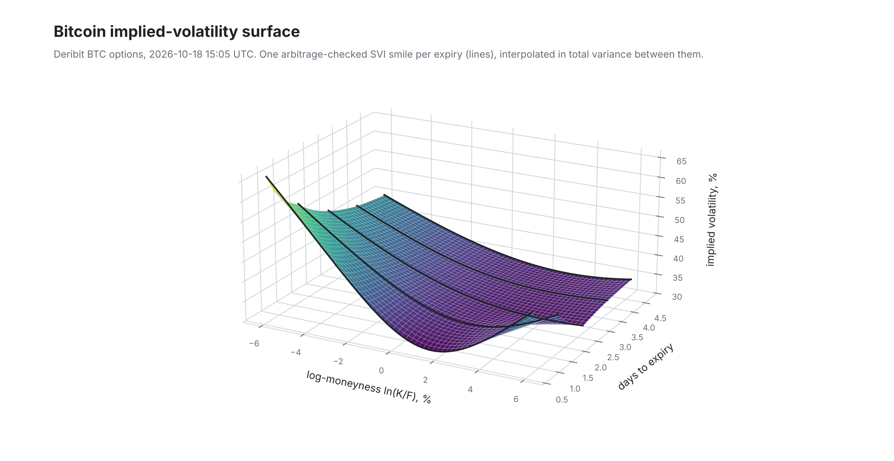

# Implied Odds

**Do prediction markets and options markets agree on the odds of the same event, and when they disagree, who is right?**

<p align="center">
  <picture>
    <source media="(prefers-color-scheme: dark)" srcset="assets/density_collapse_dark.png">
    
  </picture>
</p>

Implied Odds compares Kalshi's S&P 500, Nasdaq-100 and Bitcoin contracts with the probabilities implied by option
prices (SPX/NDX options via Breeden–Litzenberger on SVI smiles; Deribit for Bitcoin). It runs a live data pipeline in
the cloud, paper-trades the gap under fixed rules, and judges every idea with tests written down *before* the data
that decides them exists.

> Research and paper trading only. Nothing here is financial advice, and no strategy in this repo has passed the
> evidence bar for real money.

## Why trust anything here

Most backtests are wrong because the rules were chosen after seeing the results. This project is built around not
doing that:

- **Pre-registration.** Every test has a `research/PREREGISTRATION_*.md` file fixing the data window, the statistic,
  the confidence interval and the reading rule. The git commit that adds the file is its timestamp, and it predates
  the data it is judged on. Changes before results are dated amendments; nothing changes after.
- **A locked holdout.** Kalshi data from 2026-04-01 to 2026-09-30 was sealed on 2026-10-03, before any calibration
  result, and used once per hypothesis.
- **A multiple-testing ledger.** `research/ledger_claims.csv` lists every inferential claim the project has made;
  `research/ledger.py` adjusts them with Holm and Benjamini–Hochberg–Yekutieli (Harvey & Liu 2015), including a
  sensitivity run with the number of tests doubled for comparisons never written down.
- **Honest uncertainty.** Intervals resample whole days (snapshots within a day are not independent). Post-hoc
  findings are labelled post hoc and become new forward tests rather than conclusions.
- **Tested tools.** `python run_tests.py`: Breeden–Litzenberger recovers known densities, the smile fit refuses
  arbitrage, no strategy can see future prices, the robustness layer rejects pure noise and finds a planted edge.

## How it works



<p align="center">
  <picture>
    <source media="(prefers-color-scheme: dark)" srcset="assets/vol_surface_dark.png">
    
  </picture>
</p>
<p align="center"><sub>Rotate it yourself: <a href="assets/vol_surface.stl">assets/vol_surface.stl</a> opens in GitHub's interactive 3D viewer. Figures are regenerated with <code>tools/make_readme_visuals.py</code> and use option prices only.</sub></p>

- **Stocks:** every 30 minutes on weekdays during US market hours.
- **Bitcoin:** every hour, all week. Deribit options expire at 08:00 UTC and Kalshi settles on the hour, so
  `implied/crypto.py` moves the smile to Kalshi's settlement time, keeping its shape in standard deviations.
- **Execution realism (layer 5x):** seconds after each paper trade, the bot re-reads Kalshi's public order book to see
  whether the quote was still there when a real order would have landed, and later checks the public trade prints.

## Layers and verdicts

| Layer | Question | Status |
|---|---|---|
| Robustness | Deflated Sharpe, probability of backtest overfitting (CSCV), permutation tests (`robustness/`) | Done, tested |
| Strategy discovery | 2,120 rule-based strategies on SPY and sector ETFs: how much survives out of sample? | Done |
| 1–4, 6 | Kalshi calibration; Kalshi vs Polymarket; who leads price discovery; Hawkes self-excitation | Done |
| 5 | Options-implied fair value vs Kalshi (stocks and Bitcoin), fee-inclusive paper trading | Live; verdict **2026-11-30** |
| 5s | Is layer 5's Bitcoin edge only in bets that the price will *not* move far? (post-hoc idea, forward test) | Live; verdict **2026-11-09** |
| 5x | Would layer 5's paper trades have filled? Order-book requotes and public trade prints | Live; read with layer 5 |
| 7 / 7b | How fast Kalshi's daily and hourly contracts price an index move | Collecting; **2026-11-30** |
| 11 / 11b | Sell Bitcoin downside long shots on fear / negative-funding days | Live; **2027-02-01** |
| 12 | A candlestick foundation model (Kronos) vs Kalshi | Kalshi wins at 1h; forward run **2027-02-01** |
| 13 / 13b / 13c / 13d | A blend of Kalshi's price and a realized-volatility lognormal; traded live; meta-label filter; seasonal-vol variant | Passed holdout test A; live; **2027-02-01** |
| 14 / 14b | An LLM review committee on live trades; a daily LLM news scout scored against baselines | Live, logging only; **2027-05-01** |
| 15 / 16 | Is the options-vs-Kalshi gap Kalshi's mistake or the options' risk premium? Forward test of a rescaling | **2026-11-30** / from 2026-12-01 |

## What has been found (completed studies)

- **Kalshi's S&P 500 daily range contracts are well calibrated** over 1,129 trading days. A small favourite–longshot
  bias exists in the last hours but is not profitable after the spread and fees, and it has faded since 2022.
- **Kalshi and Polymarket agree.** Both venues settle identically, neither forecasts better on the S&P, a package
  guaranteed to pay $1 never cost less than $1.045, and when they disagree both move toward each other: no venue
  leads.
- **Searching harder makes backtests worse.** The best of 1,000 rules by 2000–2012 Sharpe (1.02 in sample) earned
  0.05 out of sample against 0.92 for holding SPY. Deflated Sharpe, PBO and permutation tests all flagged it.
- **Kalshi trading is self-exciting**, but in short bursts (2–4 minutes) once day-to-day level differences are
  modelled; the pre-registered model overstated it, and the correction is documented.
- **A Kalshi + realized-volatility blend beat Kalshi's own price** on the sealed holdout at 3 hours (Brier −0.0017,
  97.5% interval −0.0027 to −0.0005). Its live forward test (13b) decides on 2027-02-01.
- **The ledger** (58 claims as of 2026-10-10): 34 have p < 0.05 on their own, 19 survive the false-discovery
  adjustment. Calibration slopes and every "best of a search" result do not.

The full write-up of each study, including the errors found and fixed along the way, is in
[`research/RESEARCH_LOG.md`](research/RESEARCH_LOG.md).

## Live paper trading: an honest snapshot (2026-10-16)

Layer 5's Bitcoin paper trader went from +$2,074 to −$90 and back to about +$680 in one week, because its trades
cluster: a ladder of neighbouring strikes is one bet on how far Bitcoin moves. Option prices carry a volatility
risk premium, so when the options say a big move is more likely than Kalshi does, the options are often the biased
side. Across layer 5's settled trades (stocks and Bitcoin, all cases where the two disagreed by 3+ cents), Kalshi's
prices have scored slightly better so far (Brier 0.126 vs 0.130).

Splitting the trades by bet type after the fact suggested the edge lives in bets that Bitcoin will *not* move far.
That split was found by looking, so it proves nothing; it was pre-registered the same evening as layer 5s and is
being tested only on new trades. The execution check finds that roughly half of the quoted size is gone about 18
seconds after the snapshot. None of these numbers is a verdict; the verdict dates above are.

## Repository map

```
implied/        Breeden–Litzenberger, SVI fit with arbitrage checks, Kalshi ladder maths, Deribit → Kalshi time shift
collect/        snapshot collectors (Cboe, Kalshi, Polymarket, Deribit), history pullers, data validators
trade/          live paper traders, settlement, execution check (5x), LLM committee and scout, dashboard data
research/       one script per study, every pre-registration, the ledger, the research log
robustness/     deflated Sharpe, PBO via CSCV, minimum track record, Masters permutation tests
strategies/     the rule library and backtester used by strategy discovery
microstructure/ Hawkes self-excitation model
dashboard/      exchange-style local dashboard (reads data produced by the private pipeline)
tests/          python run_tests.py
```

Collectors use only the Python standard library; analysis needs `numpy`, `pandas`, `scipy` (see `requirements.txt`).

## Data

Raw market data belongs to the venues it comes from and is not redistributed here. The collectors fetch it from
public endpoints (Cboe delayed quotes, Kalshi's and Polymarket's public APIs, Deribit, Coinbase) into `data/`, which
is git-ignored. The live pipeline runs in a separate private repository; this repository mirrors its code, tests,
pre-registrations and write-ups.

## License

MIT (see `LICENSE`). Written by Tave La Rocque, UBC Integrated Engineering.
